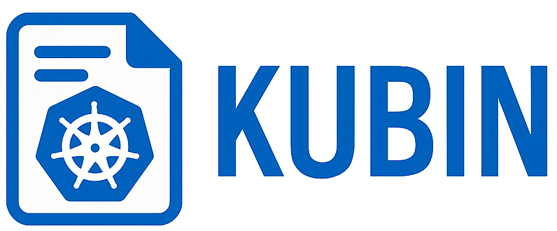
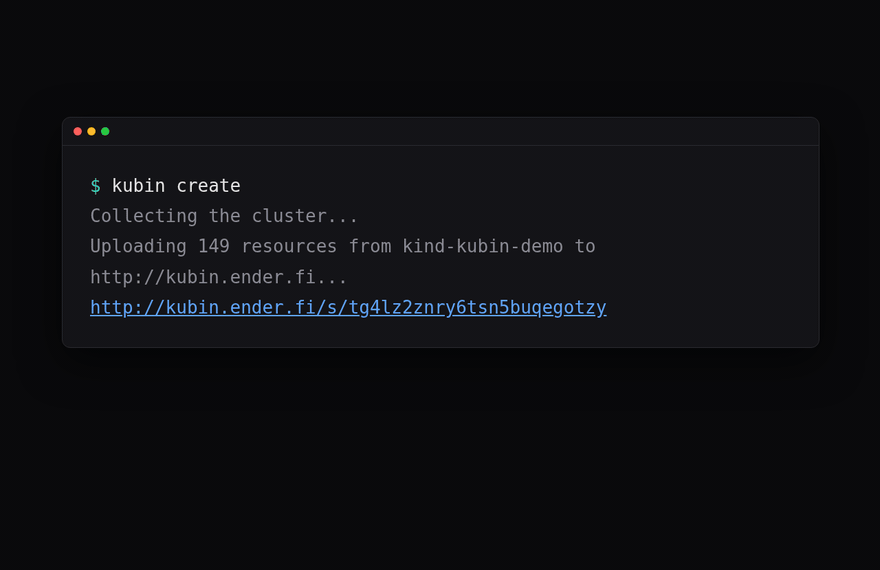

<p align="center">
  
</p>

<p align="center">Kubin turns a crashing pod into a link that shows its status, events, and logs.</p>

<!-- Narrated walkthrough goes here: drag the mp4 into the GitHub editor so it plays inline. Script: demo/video-script.md -->



```sh
git clone https://github.com/3nd3r1/kubin.git
cd kubin
./demo/run.sh
```

The demo needs Docker, kind, kubectl, Go, and curl. It builds and starts Kubin, creates a local cluster, applies the failing pod, and uploads a snapshot. Open the URL printed by the script. Kubin listens on port 8080; set `KUBIN_PORT` to use another. The cluster and server stay running until you remove them with the commands printed at the end.

## What works

`kubin create` captures namespaces, nodes, pods, workloads (Deployments, ReplicaSets, StatefulSets, DaemonSets, Jobs, CronJobs), Services, EndpointSlices, Ingresses, ConfigMaps, volumes and claims, events, and container logs. Kinds you have no RBAC for are skipped with a warning. `--namespace` and `--exclude-namespace` narrow the capture, `--no-logs` leaves logs out, `--context` picks the kubeconfig context, and `--max-size` (64Mi by default) stops an oversized upload. The snapshot link opens a read-only page with the pod status, events, and logs.

## What does not

The page shows only pods so far; the other kinds are in the snapshot but not on screen. There is no authentication, and the repository does not publish a release image yet. See [the roadmap](backlog/docs/doc-1%20-%20Direction.md) for planned work and [self-hosting](docs/self-hosting.md) for running the server yourself.

## Development

```sh
nix-shell
backlog board
```

More in [docs/development.md](docs/development.md). The system design is in [docs/architecture.md](docs/architecture.md).

## License

MIT
