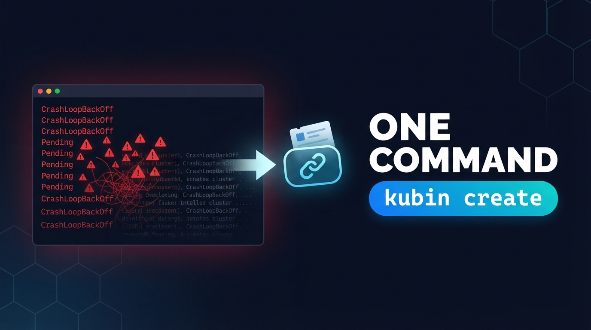

<p align="center">
  
</p>

<p align="center">Capture a broken Kubernetes cluster with one command and put the link in a ticket, instead of pasting a log dump.</p>

[](https://www.youtube.com/watch?v=4R4l0JQBz2E)


```sh
git clone https://github.com/3nd3r1/kubin.git
cd kubin
./demo/run.sh
```

The demo needs Docker, kind, kubectl, Go, and curl. It builds and starts Kubin, creates a local cluster with a broken checkout app, and runs `kubin create` for you. Open the URL printed by the script. Kubin listens on port 8080; set `KUBIN_PORT` to use another. To run `kubin create` yourself, use `./demo/setup.sh` instead: it does everything but the snapshot and prints the `export` line that puts `kubin` on your path. `k9s` comes with `nix-shell`. The cluster and server stay running until you remove them with the commands printed at the end.

## What works

`kubin create` captures namespaces, nodes, pods, workloads (Deployments, ReplicaSets, StatefulSets, DaemonSets, Jobs, CronJobs), Services, EndpointSlices, Ingresses, ConfigMaps, volumes and claims, events, and container logs. Kinds you have no RBAC for are skipped with a warning. `--namespace` and `--exclude-namespace` narrow the capture, `--no-logs` leaves logs out, `--context` picks the kubeconfig context, and `--max-size` (64Mi by default) stops an oversized upload. Secrets are not collected, and env var values stay out of the snapshot. The snapshot link opens a read-only page. It shows the problems first (pods that need attention, failing workloads, recent warning events), a sidebar with a list per kind and namespace, and detail pages with status, events, logs and YAML.

## What does not

There is no authentication, and the repository does not publish a release image yet. See [the roadmap](backlog/docs/doc-1%20-%20Direction.md) for planned work and [self-hosting](docs/self-hosting.md) for running the server yourself.

## Development

```sh
nix-shell
backlog board
```

More in [docs/development.md](docs/development.md). The system design is in [docs/architecture.md](docs/architecture.md).

## License

MIT
